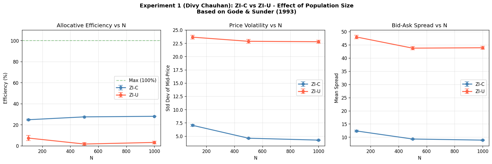

# Agent-Based Market Simulation

A continuous double-auction simulator with ZI-C, ZI-U, Gjerstad–Dickhaut and Roth–Erev trading agents.

## Run

```sh
python3 -m venv .venv
source .venv/bin/activate
python -m pip install --upgrade pip
python -m pip install -e '.[test]'
python -m pytest -q
python -m market_sim --quick --output results/local-quick
python -m market_sim --output results/local-full
```

Use a new output folder for each run. Tables, figures and run logs are saved automatically.

## Verification

25 tests passed. All 250 full simulations completed. The 180 ZI-C/ZI-U runs reproduce the original notebook results exactly: mean efficiency 26.72% versus 4.03%.



## Experiments

| Experiment | Full settings |
|---|---|
| Constraints | ZI-C vs ZI-U; 100/500/1,000 agents; 30 seeds; 300 ticks |
| Mixed market | Three homogeneous populations and one mixed population; five seeds; 400 ticks |
| Head-to-head | ZI-C, GD and Roth–Erev together; 50 seeds; 1,000 ticks |

`--experiment constraints`, `mixed_market` or `head_to_head` runs one experiment. Quick runs check execution; use full runs for research results.

## Files

- `src/market_sim/`: agents, order book, market, metrics and experiments.
- `tests/`: agent behavior, matching, accounting and reproducibility.
- `results/verified/`: verified full-run outputs.
- `docs/methodology.md`: assumptions and changes from the notebook.

Team coursework, reorganized as a standalone package. Original contributor credits remain as brief module docstrings.
